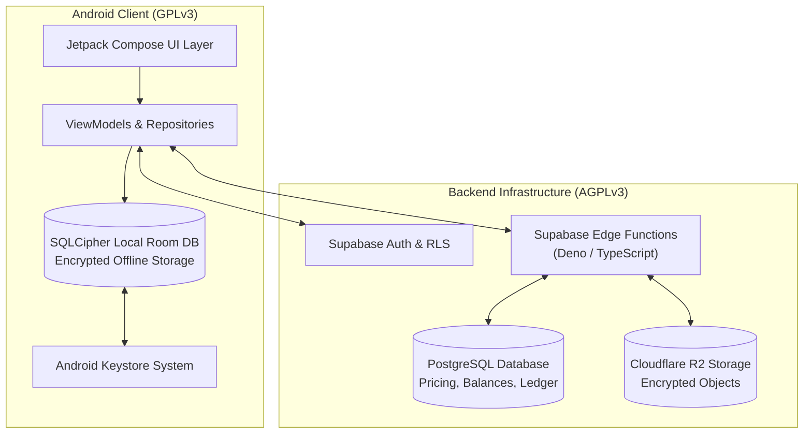
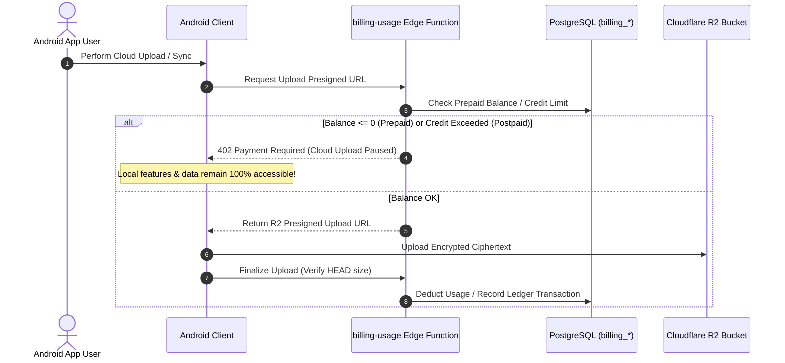

# Keeftalk System Architecture

Keeftalk is built as a zero-knowledge, privacy-first Super App for Android paired with a serverless pay-as-you-go backend infrastructure.

---

## 🏛️ High-Level System Architecture

---

## 🔒 Security & Data Sovereignty Architecture

1. **Zero-Knowledge Encryption:**
   - Account Encryption Keys (AEK) and Per-Conversation Keys (PCK) derived on-device using Argon2id.
   - Files and message payloads encrypted via `AES-256-GCM` before uploading to Cloudflare R2 or Supabase DB.
2. **Offline-First Storage:**
   - All 19+ Super App modules store data locally in Room encrypted with **SQLCipher**.
   - Cloud synchronization is completely optional and non-blocking.
3. **Multi-Tenant Row Level Security (RLS):**
   - User database tables (`billing_balances`, `billing_usage`, `billing_invoices`) enforce strict RLS policies (`auth.uid() = user_id`).

---

## 💳 Dual Pay-as-You-Go Billing Architecture

### Formula for Customer Rates
$$\text{Rate} = \text{Base Cost} \times (1 + 12\% \text{ Maintenance Allocation}) \times (1 + 5\% \text{ Founder Margin})$$

Rates are authoritatively managed by the backend (`billing_pricing` table) with decimal precision (`NUMERIC(18,6)`).
