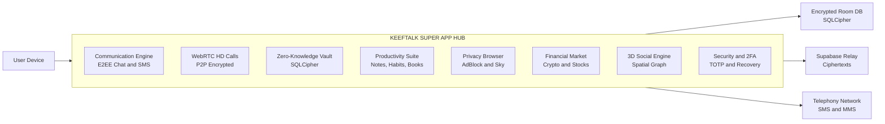
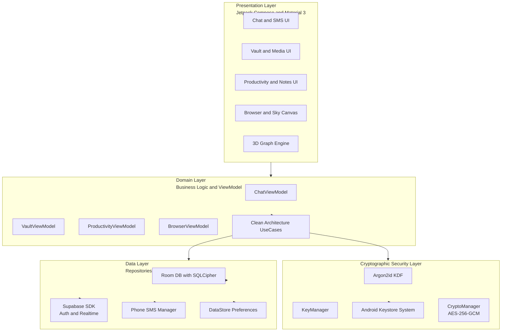
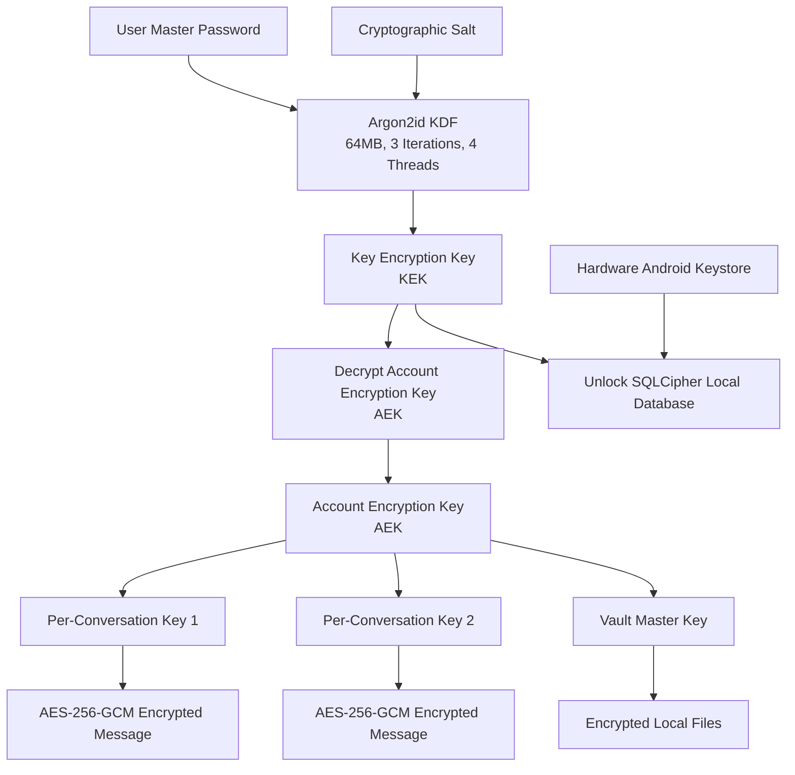
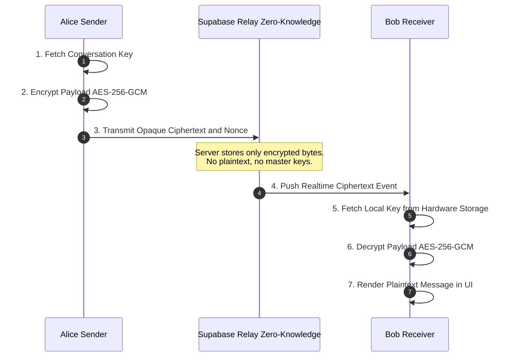
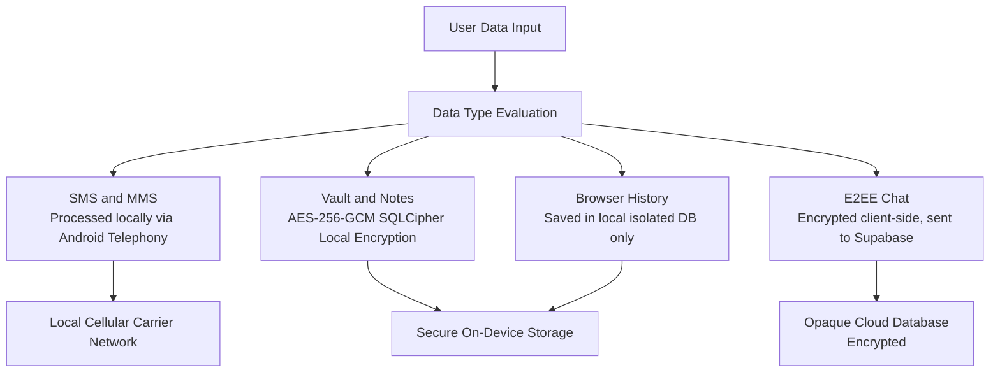

<p align="center">
  
</p>

<h1 align="center">Keeftalk</h1>

<p align="center">
  <b>The Zero-Knowledge Privacy-First Super App for Android</b><br/>
  Unified E2EE Messaging • Native SMS/MMS Client • Hardware Vault • Productivity Suite • Astronomical Privacy Browser • 3D Social Engine
</p>

<p align="center">
  <a href="#-version"></a>
  <a href="#-tech-stack--architecture"></a>
  <a href="#-tech-stack--architecture"></a>
  <a href="#-cryptographic-architecture"></a>
  <a href="#-tech-stack--architecture"></a>
  <a href="#-tech-stack--architecture"></a>
  <a href="#-license"></a>
</p>

---

## 📑 Table of Contents
- [📖 Concept & Core Philosophy](#-concept--core-philosophy)
- [➕ The 19 FAB Quick-Access Features (`+` Menu)](#-the-19-fab-quick-access-features--menu)
- [✨ Version 1.1 Features Breakdown](#-version-1-1-features-breakdown)
- [📐 System Architecture & Diagrams](#-system-architecture--diagrams)
  - [Ecosystem Feature Matrix](#ecosystem-feature-matrix)
  - [Layered Technical Architecture](#layered-technical-architecture)
  - [Zero-Knowledge Key Derivation & Cryptographic Flow](#zero-knowledge-key-derivation--cryptographic-flow)
  - [End-to-End Encrypted Message Delivery Pipeline](#end-to-end-encrypted-message-delivery-pipeline)
  - [Zero-Knowledge Data Privacy Model](#zero-knowledge-data-privacy-model)
- [🛡️ Privacy Policy (v1.1)](#️-privacy-policy-v11)
- [📜 Terms of Service (v1.1)](#-terms-of-service-v11)
- [🏗 Tech Stack & Dependencies](#-tech-stack--dependencies)
- [📦 Project Structure](#-project-structure)
- [🛠️ Building & Installation](#️-building--installation)
- [🤝 Security Disclosures](#-security-disclosures)
- [⚖️ License](#️-license)

---

## 📖 Concept & Core Philosophy

In an era dominated by corporate data harvest, pervasive advertising tracking, and fragmented single-purpose applications, **Keeftalk v1.1** introduces a revolutionary paradigm: **The Zero-Knowledge Super App**.

Keeftalk merges your communications, confidential files, productivity tools, web browsing, financial tracking, and social interactions into a single, unified Android experience—without sacrificing an ounce of privacy. 

### Core Pillars
1. **Zero-Knowledge Data Sovereignty:** You, and only you, hold the keys to your digital life. Master encryption keys are derived on-device using Argon2id and never touch any server in plaintext. Remote cloud relays (powered by Supabase) store only unreadable, opaque ciphertexts (`AES-256-GCM`).
2. **Zero Advertising, Zero Monetization of Data:** Keeftalk contains zero ad networks, zero third-party telemetry, and zero behavioral profiling SDKs.
3. **Hardware Security Integration:** Sensitive data in local Room databases is encrypted via **SQLCipher**, secured by hardware-backed keys inside the **Android Keystore System** (`isInsideSecureHardware`).
4. **Offline First & Seamless Telephony:** Keeftalk functions flawlessly offline. When connectivity is available, cloud sync handles E2EE data seamlessly. Integrated Android Telephony enables dual-SIM SMS/MMS fallbacks within the same conversation thread.
5. **Sovereign Regional Cloud Residency:** Users choose their preferred regional cloud residency (EU, US, Asia) for absolute regulatory compliance (GDPR, CCPA, HIPAA-level privacy).

---

## ➕ The 19 FAB Quick-Access Features (`+` Menu)

At the heart of Keeftalk's intuitive navigation is the adaptive **Floating Action Button (`+` FAB)**. Tapping the `+` button opens the unified control hub, providing instant one-tap access to all **19 core Super App modules**, complete with realtime unread badge counters and quick tools (Night Mode, Text Scaling A+/A-, Search, and Notification Center):

1. **My Chats:** Signal-inspired end-to-end encrypted messaging with Account Encryption Keys (AEK) and Per-Conversation Keys (PCK), voice notes, reaction pickers, thread replies, and media compression.
2. **My Calls:** Peer-to-peer low-latency encrypted voice and video calls powered by WebRTC with adaptive bitrate streaming.
3. **My SMS/MMS:** Native Android Telephony integration enabling seamless sending and receiving of carrier SMS/MMS threads alongside cloud messages with dual-SIM selection.
4. **My Notes:** WYSIWYG rich text editor featuring live Markdown previews, audio note attachments, embedded inline images, and searchable tag organization.
5. **My Vault:** Isolated hardware-backed secure storage container encrypted via SQLCipher and protected by biometric or PIN authentication, supporting direct cloud imports from Google Drive, Dropbox, and Google Photos.
6. **My Secrets:** Built-in TOTP Two-Factor Authentication (2FA) authenticator compatible with Google Authenticator and Aegis, QR code scanner, password generator, and encrypted credential vault.
7. **My Calendar:** Encrypted agenda scheduler, prioritized task reminders, birthdays, meetings, and goal planner with customizable notification alerts.
8. **My Wallet:** Secure payment tracker, QR code scan-and-pay utility, and digital asset fund ledger.
9. **My Finances:** Comprehensive expense and income tracking, budget management, and financial analysis tools.
10. **My E-Mail:** Secure email client for managing accounts, composing encrypted messages, and organizing inbox threads with quick avatars.
11. **My Feed:** Personal RSS and Atom XML feed reader featuring distraction-free article extraction and category filters (Tech, Science, Economy, Culture).
12. **My Books:** Full-featured EPUB and PDF e-book reader with custom typography, bookmarks, dark mode, and a gamified **Reading XP System** rewarding reading milestones.
13. **My Docs:** Multi-format document and spreadsheet viewer with page thumbnails, text searching, and annotation tools.
14. **My Market:** Real-time financial tickers, cryptocurrency prices, interactive candlestick and line charts, market cap rankings, and watchlists.
15. **My Habits:** Habit tracker supporting custom schedules, streak counters, completion heatmaps, and statistical progress charts.
16. **My Todo:** Prioritized task management list with due dates, priority sorting, and completion checklists.
17. **My Browser:** Privacy web browser with built-in ad blocker, tracker mitigation, custom user-agents, and a **Live Astronomical Sky Engine** rendering real-time celestial physics.
18. **My Maps:** Secure saved places, interactive map tools, and location tracking powered by MapLibre GL.
19. **My Din:** Spiritual and lifestyle tracker tailored for prayer schedules, Qibla compass, Quran reading, and daily reminders.

---

## ✨ Version 1.1 Features Breakdown

### 1. Unified E2EE Communications & Carrier SMS/MMS
- **Signal-Inspired E2EE Messaging:** Utilizes Account Encryption Keys (AEK) and Per-Conversation Keys (PCK) derived via Argon2id + AES-256-GCM.
- **Native Android Telephony (SMS/MMS):** Full default SMS app capability. Seamlessly send and receive carrier SMS/MMS threads alongside E2EE cloud messages with dual-SIM selection.
- **Rich Media & Interactivity:** Voice notes with waveforms, customizable reaction pickers, threaded reply trees, self-destructing message expiration timers, on-device media compression, and realtime typing indicators.
- **Offline Outbox Queue:** Offline messages automatically queue and send upon reconnection with full state persistence.

### 2. Encrypted P2P HD Voice & Video Calls
- **WebRTC Engine:** Peer-to-peer, low-latency, end-to-end encrypted audio and video calling.
- **Adaptive Bitrate Streaming:** Smooth call quality over 3G, 4G, 5G, and Wi-Fi networks.
- **Call History & Management:** Encrypted local call log manager with call duration analytics and contact filtering.

### 3. Hardware-Backed Zero-Knowledge Vault
- **SQLCipher + Android Keystore:** Isolated local vault container with hardware-bound encryption keys.
- **Biometric & PIN Authentication:** Protected by Fingerprint, 3D Face Unlock, or Master PIN with configurable timeout locks.
- **Direct Cloud Import:** Import documents and media directly from Google Drive, Dropbox, and Google Photos into encrypted local storage.
- **Encrypted Portable Vault Archives:** Export and restore zero-knowledge `.vault.zip` backups with key preservation across devices.

### 4. Encrypted Productivity & Workspace Suite
- **Rich Notes & Live Markdown:** WYSIWYG editor with live Markdown preview, audio note attachments, embedded image inline view, and tag categorization.
- **PDF & Document Engine:** Integrated PDF viewer with page thumbnails, text searching, annotations, and multi-sheet spreadsheet capabilities.
- **Habit Tracker & Heatmaps:** Custom recurring schedules, streak counters, completion heatmaps, and statistical completion charts.
- **E-Book Reader & Gamified Reading XP:** Full EPUB/PDF reader with customizable typography, dark mode, page bookmarks, and a **Gamified Reading XP System** rewarding daily reading streaks!
- **Calendar & Task Agenda:** Encrypted schedule planner with prioritized To-Do lists, due date alerts, and customizable notification triggers.

### 5. Privacy Browser & Environmental Astronomical Sky Engine
- **Privacy Web Browsing:** Built-in ad blocker, tracker mitigation, custom user-agent toggling, multi-tab layout manager, and glassmorphic address bar UI.
- **Live Environmental Astronomy Engine:** The browser backdrop features a real-time physics-driven celestial renderer calculating sun trajectory, precise moon phases, real star fields, and ambient weather atmospheric physics based on local position!

### 6. Personal RSS Feed Reader
- **Distraction-Free Content:** Clean article extraction with category filters (Technology, Science, Economy, Culture) and custom RSS/Atom XML feed support.

### 7. Financial Portfolio & Market Ticker
- **Realtime Market Intelligence:** Live stock market indexes, cryptocurrency tickers, interactive line/candlestick charts, market cap rankings, and personalized watchlists.

### 8. Interactive 3D Social Connection Graph
- **Custom 3D Rendering Engine:** Visualize your personal contacts and mutual connections in an interactive 3D spatial force graph, illustrating interaction paths and relationship weights.

### 9. Security, 2FA & Privacy Control Center
- **Built-in 2FA Authenticator:** TOTP token generator compatible with Google Authenticator & Aegis standards, alongside Email OTP verification.
- **Offline Emergency Recovery Keys:** Generate single-use offline recovery phrases for account recovery without server intervention.
- **Session Manager:** View all active logged-in devices and remotely terminate untrusted sessions with one click.
- **App Lock & Screenshot Protection:** Disable screenshot capture system-wide and enforce immediate biometric re-authentication.

### 10. Personalization & Digital Wellbeing
- **Material You Dynamic Colors:** Wallpaper-derived accent palettes, dark/light contrast modes, and custom bottom navigation layout arrangements.
- **"Time on Keeftalk" Dashboard:** Native digital wellbeing screen-time metrics to monitor digital usage patterns.

---

## 📐 System Architecture & Diagrams

### Ecosystem Feature Matrix



---

### Layered Technical Architecture



---

### Zero-Knowledge Key Derivation & Cryptographic Flow



---

### End-to-End Encrypted Message Delivery Pipeline



---

### Zero-Knowledge Data Privacy Model



---

## 🛡️ Privacy Policy (v1.1)

**Effective Date:** January 1, 2026  
**Publisher:** Keeftalk LLC  

At Keeftalk LLC, privacy is not a setting—it is the foundational architecture of our software. This Privacy Policy details how Keeftalk handles your data.

### 1. Zero-Knowledge Principle
Keeftalk operates as a Zero-Knowledge ecosystem. We do not possess the cryptographic keys required to decrypt your messages, notes, vault files, or passwords.
- **Your Master Password:** Never transmitted to or stored on any server.
- **Your Encryption Keys:** Generated and held exclusively on your client device.
- **Your Cloud Backups:** Fully encrypted with client-side derived keys prior to upload.

### 2. Information We Do NOT Collect
- We **do not** collect or track your browsing activity in the Privacy Browser.
- We **do not** log your IP address or associate it with your chat activity.
- We **do not** harvest your contact book or upload phone contacts to remote servers without explicit user-initiated invite requests.
- We **do not** sell, rent, monetise, or share any personal data with advertisers or data brokers.
- We **do not** include any third-party tracking or behavioral analytics SDKs (e.g., Facebook SDK, Google Analytics, Firebase Analytics).

### 3. Information We Process & Technical Operation
- **Account Registration:** Minimal account credentials (email address or username) required solely for cloud synchronization relay authentication.
- **E2EE Messages & Attachments:** Transmitted through encrypted cloud relays (Supabase) in opaque ciphertext form (`AES-256-GCM`). Once delivered, ciphertexts are automatically removed or maintained in encrypted state according to user-selected retention schedules.
- **SMS/MMS Processing:** Processed entirely on your device using Android standard telephony APIs. Telephony data is never uploaded to Keeftalk servers.
- **Local Biometrics:** Utilizes native Android `BiometricPrompt` APIs. Biometric templates are stored securely inside your device's Secure Element/TEE and are never accessible to Keeftalk.

### 4. Cloud Data Residency & Regional Storage
Users have the explicit option in **Settings -> Security & Privacy Center** to select their cloud data region (e.g., European Union, United States, Asia Pacific). All cloud interactions conform strictly to GDPR, CCPA, and applicable global data privacy frameworks.

### 5. Data Retention & Right to be Forgotten
You retain complete ownership over your data:
- **Instant Local Wipe:** Reset or clear local data at any time via Settings.
- **Account Deletion:** Request complete account deletion directly within the app (**Settings -> Delete Account**). Deletion immediately purges all cloud account records and associated encrypted relays permanently.

---

## 📜 Terms of Service (v1.1)

**Effective Date:** January 1, 2026  
**Version:** 1.1 Release  

Please read these Terms of Service ("Terms") carefully before using the Keeftalk mobile application ("Application" or "Service") operated by Keeftalk LLC ("us", "we", or "our").

### 1. Acceptance of Terms
By installing, accessing, or using Keeftalk, you agree to be bound by these Terms. If you do not agree to all terms, you must not use or install the Application.

### 2. Cryptographic Responsibilities & Key Management
Because Keeftalk uses Zero-Knowledge cryptography:
- **Master Password & Recovery Keys:** You are solely responsible for maintaining the confidentiality and safety of your Master Password and Emergency Offline Recovery Key.
- **Loss of Access:** **KEEFTALK LLC CANNOT RESET YOUR PASSWORD OR RECOVER YOUR ENCRYPTED VAULT DATA IF YOU LOSE BOTH YOUR MASTER PASSWORD AND RECOVERY PHRASE.** Keeftalk LLC expressly disclaims all liability for data loss resulting from forgotten passwords or lost recovery keys.

### 3. Acceptable Use Policy
You agree not to use Keeftalk for any unlawful activities, including but not limited to:
- Transmitting illegal content, malware, or unlawful materials.
- Attempting to disrupt, overload, or compromise the integrity of Keeftalk cloud relay infrastructure.
- Attempting to reverse engineer, decompile, or modify software binaries for malicious exploitation.

### 4. Telephony & Emergency Services Disclaimer
- Keeftalk provides native carrier SMS/MMS integration using your phone provider's SIM card. Standard messaging rates from your cellular carrier apply.
- WebRTC voice/video calls inside Keeftalk rely on data/Wi-Fi connection and **do not support emergency services calls (e.g., 911, 112, 999)**. Use your cellular dialer for emergency calls.

### 5. Digital Subscriptions & In-App Purchases
Certain features or premium storage allocations may require digital subscriptions processed securely through Google Play Billing. All purchases are governed by Google Play Store terms and applicable refund policies.

### 6. Limitation of Liability & Warranty Disclaimer
THE APPLICATION IS PROVIDED "AS IS" AND "AS AVAILABLE" WITHOUT WARRANTIES OF ANY KIND, EXPRESS OR IMPLIED. KEEFTALK LLC SHALL NOT BE LIABLE FOR ANY INDIRECT, INCIDENTAL, CONSEQUENTIAL, OR SPECIAL DAMAGES ARISING OUT OF YOUR USE OR INABILITY TO USE THE SERVICE.

---

## 🏗 Tech Stack & Dependencies

| Layer | Technologies & Frameworks |
| :--- | :--- |
| **Language & Runtime** | 100% Kotlin • Kotlin Coroutines & StateFlow • Target SDK 37 (Android 16) • Min SDK 26 (Android 8.0) |
| **UI Framework** | Jetpack Compose • Material Design 3 • Navigation 3 • Adaptive Layouts • Accompanist |
| **Security & Crypto** | SQLCipher for Android • Hardware-Backed Android Keystore • Argon2id (Memory-Hard KDF) • AES-256-GCM |
| **Local Storage** | Room Database • Encrypted DataStore Preferences • FileProvider |
| **Networking & Cloud** | Supabase Kotlin SDK (Auth, Realtime WebSockets, Postgrest, Storage) • Ktor Client • OkHttp3 • Retrofit |
| **Calls & Media** | WebRTC Native Android SDK • Media3 ExoPlayer • CameraX • Coil 3 & Glide Media Fetchers |
| **AI & Machine Learning** | Google ML Kit (OCR Text Recognition, Barcode Scanning, Language ID, On-Device Translator) |
| **Maps & Rendering** | MapLibre GL Android SDK • Custom 3D Canvas Spatial Engine |

---

## 📦 Project Structure

```text
tn.keeftalk.chat
├── account/          # Android Account Authenticator & Sync Services
├── data/
│   ├── analytics/    # Privacy-Preserving Aggregate Metrics
│   ├── auth/         # Cloud & Session Auth Handlers
│   ├── billing/      # Google Play Billing Integration
│   ├── cloud/        # Google Drive, Photos & Dropbox Import Drivers
│   ├── local/        # Room DB, SQLCipher DAOs, Entities & Converters
│   ├── remote/       # Supabase DTOs & Realtime DataSources
│   ├── repository/   # Repositories (Chat, Vault, Notes, Books, Habits, etc.)
│   └── service/      # Background Backup Engine & Media Processing
├── domain/
│   ├── model/        # Core Business & Security Domain Models
│   └── repository/   # Abstract Repository Interfaces
├── security/
│   └── crypto/       # KeyManager, Argon2id KDF, PCK Manager, CryptoManager
└── ui/
    ├── auth/         # Login, Registration, 2FA, Recovery Views
    ├── books/        # EPUB Reader & Gamified Reading XP
    ├── browser/      # Privacy Browser & Live Astronomical Sky Engine
    ├── call/         # WebRTC Voice & Video Call Interfaces
    ├── docs/         # PDF Reader & Spreadsheet Engine
    ├── feed/         # Personal RSS Feed Reader
    ├── habits/       # Habit Tracker & Heatmap Analytics
    ├── market/       # Financial Ticker & Market Charts
    ├── profile/      # Interactive 3D Social Connection Graph
    ├── screens/      # E2EE Chat, Vault, Notes, SMS Views
    └── theme/        # Material Design 3 Themes & Dynamic Colors
```

---

## 🛠️ Building & Installation

### Developer Prerequisites
- **Android Studio:** Ladybug (2024.2.1) or newer
- **Java Development Kit:** JDK 17
- **Android SDK:** API Level 37 (Android 16 Preview / Stable)
- **Gradle:** Version 8.x with Kotlin 2.0 compiler

### Compilation Steps

1. **Clone the GitHub Repository:**
   ```bash
   git clone https://github.com/your-org/keeftalk-android.git
   cd keeftalk-android
   ```

2. **Setup Environment Configuration:**
   Place `keystore.properties` in the root directory for signed builds:
   ```properties
   keyAlias=your_keystore_alias
   keyPassword=your_key_password
   storeFile=your_keystore_file.jks
   storePassword=your_store_password
   ```

3. **Assemble Build via Gradle:**
   ```bash
   # Build Debug APK
   ./gradlew :app:assembleDebug

   # Build Release APK / App Bundle
   ./gradlew :app:assembleRelease

   # Execute Unit & Cryptographic Robustness Tests
   ./gradlew :app:testDebugUnitTest
   ```

---

## 🤝 Contact & Support

For general questions, legal inquiries, or product feedback, reach out to the appropriate team:

- **General Support:** `support@keeftalk.com`
- **Legal & Privacy:** `legal@keeftalk.com`
- **Feedback:** `feedback@keeftalk.com`

---

## ⚖️ License

Copyright © 2026 **Keeftalk LLC**. All rights reserved.  
Licensed under proprietary and open software license terms as specified in the project repository.
